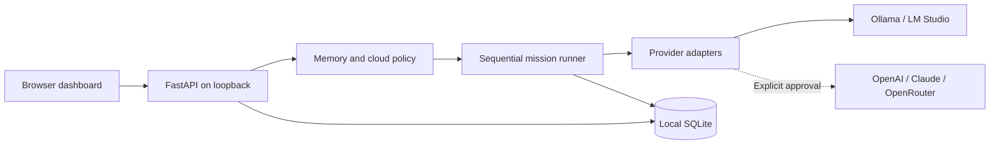

## My Bulter Enterprise

**A local-first AI team dashboard: choose each bot's model, control its memory, and watch work pass between specialists.**

Designed and built with Codex. Project author: Carter Tan. Initial implementation: 23 October 2026.

A **Bulter** is a configurable bot with a name, role, instructions and model assignment. A **mission** passes a task through one to four Bulters in a user-selected order. This is an original implementation inspired by agent-team workflows, not a copy of Grok's proprietary implementation or an affiliated product.

### Current capabilities

- Create and edit Bulters with independent provider/model assignments.
- Discover installed chat models through Ollama or LM Studio.
- Configure OpenAI, Claude or OpenRouter adapters using exact model IDs and server-held credentials.
- Save explicit private or shared notes, with local-only or cloud-approved permissions.
- Run bounded sequential handoffs with incremental output, cancellation and persistent history.
- Export individual mission records as JSON.
- Keep data in a local SQLite database; no hosted backend, telemetry or external frontend assets.

### Status

**Phase 1: working single-user local prototype.** The Enterprise name describes the project, not a production security or compliance claim.

| Integration | Evidence |
| --- | --- |
| Ollama | Live local discovery and a two-Bulter mission completed using `gemma4:e4b` |
| LM Studio | Adapter implemented; live validation pending |
| OpenAI / Claude / OpenRouter | Request construction and stream parsing tested with synthetic data; live paid validation pending |

The original machine detected four chat models. A new clone starts with no Bulters, memories or mission history: personal runtime data is deliberately excluded. Model weights are not distributed with this repository.

### Quick start on macOS

Prerequisites: Python 3.11+ (tested with 3.12.4), zsh, a browser, and a running Ollama server with a downloaded chat model. See the [complete setup guide](src/docs/SETUP.md) for installation and optional providers.

Run these commands from the repository root:

```zsh
python3 -m venv src/.venv
source src/.venv/bin/activate
python3 -m pip install -r src/requirements.txt
zsh scripts/run.sh
```

Open [the local dashboard](http://127.0.0.1:8765). Create a Bulter, select a model, then open **Missions**. Stop the dashboard with Control-C in its Terminal window. Start Ollama separately with `ollama serve` only if it is not already running.

### Architecture at a glance



See [architecture and design decisions](src/docs/ARCHITECTURE.md), including data flows, memory rules, persistence and execution limits.

### Documentation

| File | Purpose |
| --- | --- |
| [Setup](src/docs/SETUP.md) | Prerequisites, Mac installation, first mission, providers and troubleshooting |
| [Architecture](src/docs/ARCHITECTURE.md) | Components, interfaces, data model, trust boundaries and tradeoffs |
| [Build activity](src/docs/BUILD_ACTIVITY.md) | Objective, design tasks, implementation work, evidence and remaining scope |
| [Security](src/docs/SECURITY.md) | Implemented protections, limitations and handling sensitive data |
| [Publishing](src/docs/PUBLISHING.md) | Review, commit, GitHub creation/push, ZIP packaging and future updates |
| [Operator guide](src/README.md) | Detailed application behaviour and memory/provider rules |

### Source layout

```text
README.md
.gitignore
scripts/
  run.sh                  Local server launcher
  package_release.py      Allowlisted, scanned source ZIP builder
src/
  app.py                  API, policy and mission orchestration
  providers.py            Model discovery and normalized streaming
  storage.py              SQLite persistence
  requirements.txt        Pinned direct dependencies
  static/                 HTML, CSS and JavaScript interface
  tests/                  Policy, execution and packaging tests
  docs/                   Publishable project documentation
  .runtime/               Private local data (ignored; created on first start)
  .release/               Source archives (ignored; created by packaging)
```

### Validation

```zsh
python3 -m pytest src/tests -q -p no:cacheprovider
node --check src/static/app.js
python3 scripts/package_release.py --check
```

Node.js is optional for running the app; it is used only for the JavaScript syntax check. Automated provider tests use synthetic credentials and mocked responses, not paid services. See the build activity record for the distinction between automated tests and the original manual/live demonstration.

### Roadmap

- Live account-specific cloud validation and usage/cost visibility.
- Continuing conversations and mission follow-up.
- Memory search, source provenance and immutable revisions.
- Richer formatting, artifacts and review checkpoints.
- Model-specific context budgeting before more complex workflows.

These are future work, not present functionality. Autonomous computer control, web browsing, document ingestion and multi-user access are not implemented.

### License

No open-source license has been selected or added. The maintainer should choose a license before presenting this as an open-source release. Dependencies and model weights retain their own licenses; the ZIP includes neither dependencies nor model weights.

## Warnings

- Run only on loopback, with one server worker. Do not deploy this version as a public or shared enterprise service.
- Do not publish databases, notes, outputs, credentials or local screenshots. The packaging command includes only reviewed source paths.
- Memory access restrictions do not guarantee that a model's answer will avoid restating a private note during an intentional handoff.
