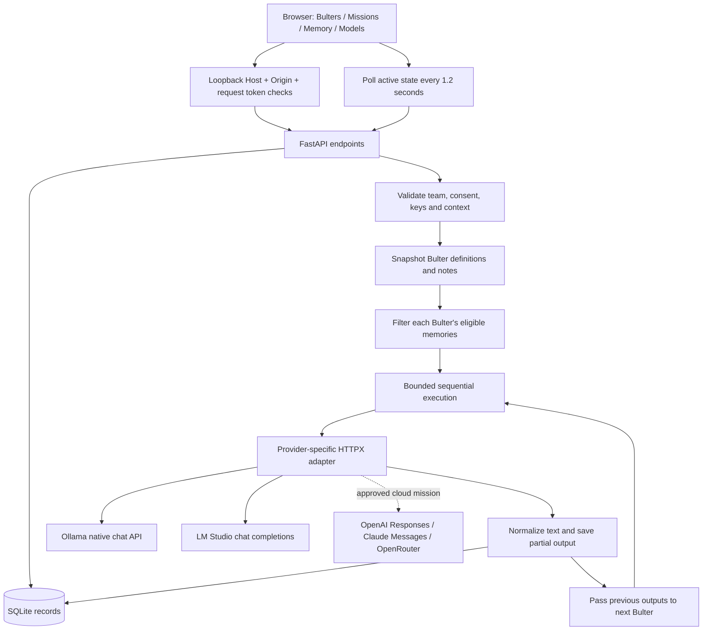
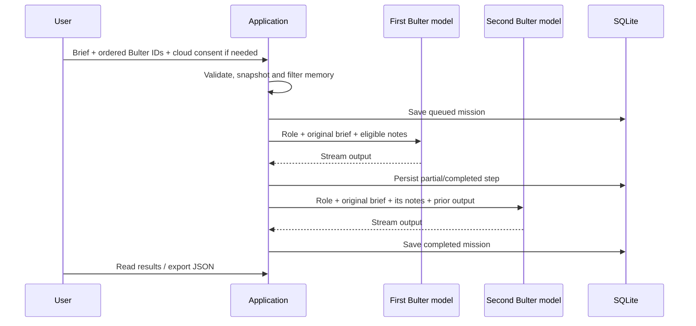

## Architecture and design decisions

### Connector extension — 27 October 2026

The [connector guide](CONNECTORS.md) documents the additional Google, Telegram and browser-MCP paths. The dashboard user explicitly fetches local-only reference snapshots and confirms frozen external-action previews. Models still have no execution tools. Connector evidence is snapshotted into local missions; any cloud step rejects it. Optional Telegram completion notices contain only the mission ID and status. Connection grants and tokens live in instance-scoped Keychain entries, while action/evidence records remain in the private SQLite runtime store. This extends the original model-only architecture below.

### Objective and assumptions

- Give one Mac user a visible team of specialist AI bots with independent model assignments.
- Keep local inference and stored context on the Mac by default.
- Make memory scope, cloud transmission and handoffs explicit.
- Prefer a small, inspectable Python application over distributed infrastructure.
- Run one application process, one active mission and at most four sequential model calls.

### Components

| Module | Responsibility |
| --- | --- |
| `static/index.html` | Accessible page structure and native forms/dialogs |
| `static/style.css` | Responsive dashboard styling; no external fonts |
| `static/app.js` | UI state, forms, model picker, polling and JSON downloads |
| `app.py` | Input validation, local request protection, memory policy, lifecycle and task orchestration |
| `providers.py` | Fixed endpoint registry, discovery, provider-specific payloads and stream parsing |
| `storage.py` | Parameterized SQLite document persistence |
| `scripts/run.sh` | Loopback-only server launch with restrictive umask |

### Mission execution

The models do not independently communicate, spawn agents or call tools. The application controls the sequence. A single-Bulter mission is the simplest chat-like interaction. A later mission starts fresh; previous mission conversations are not automatically included.

### Data model

SQLite uses one table, `records(kind, id, body)`, with a compound primary key and JSON bodies.

| Record | Main fields |
| --- | --- |
| Bulter | ID, name, role, instructions, provider, model, shared-memory flag, creation time |
| Memory | ID, title, content, optional owner ID, cloud-allowed flag, active flag, creation time |
| Mission | ID, prompt, snapshot of team definitions, cloud/consent flags, status, timestamps, error and steps |
| Embedded step | Bulter ID/name, provider/model, included memory IDs, output and status |

Whole-record writes are atomic SQLite transactions. Partial model output is saved incrementally. Stored memory IDs are not immutable copies of the note text: the activity log cannot reconstruct a historical note after it has been edited. There is no backup scheduler, encryption-at-rest layer, data deletion endpoint or migration framework in this phase.

### Memory and egress policy

A note is eligible only when it is active, belongs to the receiving Bulter or is shared with an opted-in Bulter, and satisfies the mission's egress policy.

If **any** selected provider is cloud-based, every step excludes local-only notes, including earlier local steps. This prevents the application from deliberately routing those notes indirectly through a local model's output. All selected Bulters still receive the original brief; the user must avoid placing unsuitable data in a cloud-approved brief.

Private retrieval is not output confidentiality. An owner's answer can restate its notes and is then intentionally shared with later team members. There are no separate user identities or tenant boundaries.

### Interface summary

| Endpoint | Purpose |
| --- | --- |
| `GET /` / `GET /health` | Dashboard and nonsensitive readiness |
| `GET /api/state` | Bulters, notes and mission history |
| `GET /api/providers` | Local discovery and cloud key-presence status |
| `POST /api/bulters` / `PUT /api/bulters/{id}` | Create/update Bulter |
| `POST /api/memories` / `PUT /api/memories/{id}` | Create/edit/deactivate note |
| `POST /api/missions` | Start bounded ordered mission |
| `POST /api/missions/{id}/stop` | Cancel active mission |

API requests require the process-generated `X-Bulter-Token`, delivered in the initial HTML. The token is a local browser-origin control, not a login credential or protection against malicious local processes.

### Execution limits and recovery

| Control | Current implementation |
| --- | --- |
| Concurrent missions | One per process |
| Team size | One to four unique Bulters |
| Brief length | Up to 6,000 characters |
| Constructed context | Reject above 24,000 characters; not exact token counting |
| Output budget | 2,048 requested tokens; 16,000-character application cap |
| Ollama context request | 8,192 tokens |
| Timeouts | Five-second connection; 180-second provider timeout configuration; ten-minute mission bound |
| Failure | Stop later handoffs; retain partial output |
| Cancellation | Cancel task/upstream stream; do not schedule later calls |
| Restart | Mark queued/running work interrupted; no automatic paid replay |

### Tradeoffs

- **Plain frontend:** avoids a Node build pipeline, but output remains plain text and UI state is simple.
- **SQLite:** easy local operation, but entire state is fetched and partial output is written frequently; large histories need pagination and retention controls.
- **Fixed endpoints:** reduces arbitrary URL/SSRF exposure; custom model gateways are not supported.
- **Sequential execution:** predictable memory and handoffs; no parallel agent pool or smart scheduling.
- **Explicit notes:** understandable access rules; no automatic extraction, semantic retrieval or vector index.
- **No paid retries:** avoids accidental duplicate billing; transient failures require a deliberate rerun.

## Optional local image engine

- A separate MFLUX environment uses pinned 4-bit FLUX.2 Klein 4B and Z-Image Turbo snapshots. It does not share provider credentials or Obsidian retrieval with image jobs.
- Explicit setup downloads model data. Generation runs offline in a subprocess, passes prompts over stdin, serializes GPU jobs and saves PNGs without embedded prompt metadata.
- The dashboard reads lightweight local readiness receipts through the protected `/api/image-engine` endpoint. It does not load GPU models when rendering the page.
- Image generation is currently a terminal workflow, separate from sequential text missions. See [local diagrams and pictures](LOCAL_VISUALS.md).

## Warnings

- One process is essential: the in-memory active-task guard does not coordinate multiple workers.
- The 24,000-character context bound is not a guarantee that a provider/model will accept all prompts without truncation.
- The application trusts local inference servers. Blocking known cloud-named Ollama IDs is not comprehensive attestation that a custom runtime never forwards requests.
