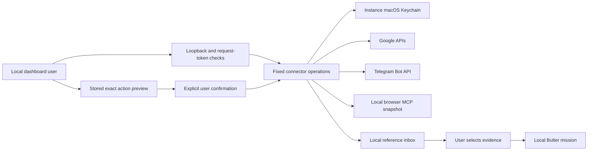

## Account connectors — 27 October 2026

### What this release does

| Connection | Available operations | Authorization |
| --- | --- | --- |
| Gmail | Search up to ten email header/snippet results; send a plain-text email to one address | Google OAuth; every send requires preview and confirmation |
| Google Calendar | Read up to thirty primary-calendar events over seven days; create, update and delete events | Google OAuth; every change requires preview and confirmation |
| Telegram | Pair a dedicated bot with your private chat; fetch incoming text; send a reviewed reply; request a generic mission-status notice | Bot token in Keychain; one-time pairing challenge; fixed recipient |
| Browser MCP | Capture the current page from a dedicated Microsoft Playwright browser | User starts browser and requests each snapshot; no model-controlled browser actions |
| LinkedIn | Manually open LinkedIn and paste information into the reference inbox | No claimed native inbox/profile-views integration |

These connectors belong to My Bulter Enterprise. Connections installed in Codex or ChatGPT are not automatically available to this separate application. Google and Telegram use official HTTP APIs directly; the browser uses MCP. Adding arbitrary MCP servers is not supported.

### Google setup on your Mac

1. In [Google Cloud Console](https://console.cloud.google.com/), create or choose a project dedicated to your local application.
2. Enable **Gmail API** and **Google Calendar API**.
3. Configure the OAuth consent screen. For personal development, add your Google account as a test user where required. Workspace administrators may restrict access.
4. Create an OAuth client with application type **Desktop app**. Keep its client ID and secret private; do not add downloaded credentials to this repository.
5. Start the app with `zsh scripts/run.sh`. Open `http://127.0.0.1:8765/` and choose **Connectors**.
6. Enter the OAuth client ID and secret directly in the dashboard. Choose **Prepare Google authorization**, then open **Continue to Google** in your normal browser.
7. Review and grant the requested permissions. The callback returns to `http://127.0.0.1:8765/oauth/google/callback`. Return to Connectors and refresh status.
8. Try a Gmail search such as `is:unread` or fetch upcoming Calendar events. Review the local result before selecting **Use in a local mission**.

The app requests `gmail.readonly`, `gmail.send`, and `calendar.events.owned`. Calendar operations are limited by the app to the primary calendar. Partial grants are rejected. PKCE and an expiring single-use state protect the loopback authorization flow; refresh credentials are stored in the instance's macOS Keychain entry. No password is requested by this application.

Gmail read access is a restricted scope. Publishing the source does not make a Google OAuth client approved for public distribution. Google verification and Workspace policy requirements depend on deployment and users. External apps in Testing may require reauthorization when refresh grants expire. Review [Google's desktop OAuth guide](https://developers.google.com/identity/protocols/oauth2/native-app), [Gmail scopes](https://developers.google.com/workspace/gmail/api/auth/scopes), and [Calendar scopes](https://developers.google.com/workspace/calendar/api/auth).

### Sending email and changing Calendar events

1. In **Prepare an action**, choose the operation and fill in the fields.
2. Choose **Prepare preview — do not send yet**. Review the exact recipient/content or event ID and dates.
3. For updates/deletions, the preview includes the current event and attendee count. A revision precondition prevents overwriting an event changed after the preview.
4. Choose **Confirm this exact action** or cancel. Previews expire after fifteen minutes. Confirmation cannot replace the stored arguments.
5. Review **Action history**. An unknown outcome means inspect Gmail/Calendar before attempting another send; the app never retries an uncertain write automatically.

Use timezone-aware values, for example `2026-10-28T09:00:00+08:00`. Event updates replace the title, description and start/end fields shown in the preview. Attendees and other fields are preserved. Updates and deletions request attendee notifications. A recurring-series ID can affect the whole series. This interface does not invite new attendees or manage other calendars.

### Telegram setup

1. Open the official [BotFather](https://t.me/BotFather) in Telegram and create a **new dedicated bot** with `/newbot`.
2. Enter its token directly in **Connectors → Telegram**. Do not paste the token into a mission, chat, terminal command or Obsidian note.
3. Choose **Prepare private-chat pairing**. Send the displayed one-time `/start ...` command to your bot in a private chat within ten minutes.
4. Choose **Check pairing command**. Pairing binds this connection to that Telegram user and private chat.
5. Send your bot a text message, then choose **Fetch incoming messages**. Select a captured message for a local mission to draft an answer. Sending the answer back uses the Telegram action preview.
6. To receive a mission completion notice, select the Telegram checkbox in the mission composer before starting that mission. Only its ID and status are sent.

The app uses on-demand polling, not public webhooks. It does not receive messages while closed, execute incoming instructions automatically, or reply unattended. Groups, other senders, documents and voice messages are ignored. A bot with an existing webhook is refused rather than taking over its integration. Do not share this dedicated bot with another polling application. Telegram retains pending updates only for a limited period; this is not a durable message-backup service. See the [Telegram Bot API](https://core.telegram.org/bots/api).

### Browser MCP and LinkedIn

Install Node.js LTS and Google Chrome if absent. From the repository root:

```zsh
zsh scripts/run_browser_mcp.sh
```

The script starts the pinned Microsoft `@playwright/mcp@0.0.83` package on `127.0.0.1:8931`; the first run downloads it through npm. In the dashboard, choose **Capture current browser page** to launch its browser. Navigate manually in that separate window, then capture again. Leave both the app and MCP terminals running while using this feature. Control-C stops each process.

Only `browser_snapshot` is exposed through the app's fixed MCP client. It does not expose clicks, navigation, JavaScript evaluation, shell commands or arbitrary tool names to Bulters. The MCP session is reused so the same browser remains selected. Browser cookies are held in an isolated session rather than a persistent profile; stopping the process loses its sign-ins. Website content is untrusted and remains local-only evidence. This does not turn Playwright itself into a security sandbox against other software on your Mac.

[Microsoft's browser MCP](https://github.com/microsoft/playwright-mcp) supports browser interaction, but LinkedIn's [open API permissions](https://learn.microsoft.com/en-us/linkedin/shared/authentication/getting-access) do not provide general personal inbox or profile-view access. LinkedIn also [restricts browser automation and scraping](https://www.linkedin.com/help/linkedin/answer/a1341387). Use LinkedIn manually and paste selected information into the reference inbox, or obtain an approved LinkedIn integration. No CAPTCHA bypass, cookie extraction or automatic LinkedIn polling is implemented.

### Architecture and security boundaries



- `connectors.py`: fixed API operations, OAuth, pairing, MCP protocol and write state machine.
- `connector_routes.py`: narrow local HTTP endpoints and sanitized validation.
- `static/connectors.js`: forms, previews, reference selection and action history.
- Credentials stay in Keychain. SQLite stores connection metadata, imported snapshots, action payloads and outcomes. Those records contain personal data and are excluded from source packaging.
- Selected evidence is rejected for any mission containing a cloud step, even if general cloud consent is enabled. No automatic import into Obsidian occurs.
- Models never receive connector tokens or execution tools. Generated text cannot authorize a send.
- Generic mission notices require per-mission opt-in and a pinned Telegram recipient. Full results are never sent automatically.
- No Python dependencies were added. Playwright MCP is an optional separately pinned Node package.

### Verification and limits

Run `src/.venv/bin/python -m pytest src/tests -q`. Connector tests use synthetic credentials and mocked APIs. They cover PKCE/state/replay, CSRF, secret non-disclosure, pairing/sender filtering, write confirmation/idempotency, Calendar revision checks, local-only evidence and JSON/SSE MCP sessions. Real Google/Telegram account verification requires your OAuth consent and bot pairing; passing mocked tests does not establish live account access.

### Warnings

- This is a single-user local app, not a multi-user or internet-facing server. Do not expose either port to the network. Use the supplied launcher with access logging disabled to avoid logging OAuth callback query strings.
- The browser MCP endpoint is not authenticated against other local processes. Stop it when not needed; use only trusted software on the Mac. Web content and reference snapshots can contain private information or malicious instructions.
- Local SQLite content is not application-encrypted. FileVault, OS account controls and backups remain important. Disconnect removes the local Keychain entry but preserves history; revoke Google access or rotate the token in BotFather separately when needed.
- Notifications are best-effort while the app runs. No scheduler, guaranteed delivery, automatic Gmail alerts, unattended Telegram assistant or production reliability claim is included.
