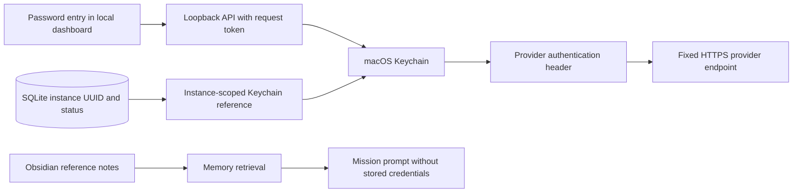

## Provider credentials and local visual generation

Reviewed 26 October 2026. Credential management and Qwen diagram generation are implemented. Pictures use a separate offline MFLUX engine because the installed Ollama runtime rejects image generation. See [Local visual setup](LOCAL_VISUALS.md) for commands and dashboard guidance.

### Add a provider API key

1. Start the application and open **Models & connections**.
2. Choose **Add API key** on OpenAI, Claude or OpenRouter.
3. Paste a provider API key into the password field and choose **Save to Keychain**. Do not paste a key into chat, a Bulter's instructions, a document upload or Obsidian.
4. Allow the app's Python process to access macOS Keychain if prompted by macOS. The dashboard cannot bypass a denied request.
5. Assign the provider and exact model ID to a Bulter. A cloud mission still requires explicit consent.

Saving makes no paid request and does not verify the key with the provider. The status remains unverified until you successfully run a mission. **Replace API key** updates this instance's entry. **Remove saved key** disconnects the entry locally; revoke a compromised key in the provider console as well.

Use separate keys and spending controls for this application. OpenRouter supports per-key credit limits. Provider API access and billing must be configured separately from this application's local installation.

### Which credentials to use

| Integration | Credential supported by this implementation |
| --- | --- |
| OpenAI model API | OpenAI Platform API key; the existing Responses adapter remains a text-model integration, not a Codex agent harness |
| Claude model API | Claude Console API key, not Claude Code subscription OAuth tokens |
| OpenRouter | Dedicated OpenRouter API key, preferably with a credit limit |
| Ollama or LM Studio local inference | No external provider API key |

The app does not import CLI credential files, browser cookies, Codex login files or Claude Code session tokens. Current OpenAI documentation describes an authorized **Sign in with ChatGPT** integration for eligible open-source clients; that is a separate OAuth implementation requiring its own scopes and consent, not a reason to copy an existing Codex token. Anthropic directs developers of applications using Claude to API-key authentication or supported cloud providers, and restricts collection or reuse of Claude.ai session credentials.

Sources: [OpenAI API authentication](https://developers.openai.com/api/reference/overview), [Sign in with ChatGPT](https://developers.openai.com/siwc/quickstart), [Claude credential-use guidance](https://code.claude.com/docs/en/legal-and-compliance), [OpenRouter authentication and limits](https://openrouter.ai/docs/api/reference/authentication).

### Storage architecture



- Each new database receives a random instance UUID. The Keychain service name is `com.mybulter.enterprise.<instance-uuid>` and the account is the provider ID.
- SQLite stores only the instance identity, provider ID, configured flag and update time. It never stores the key, encrypted key payload, key suffix or key hash.
- The backend selects the native macOS Keychain implementation explicitly. It does not auto-select a plaintext or third-party keyring backend.
- Keys are read transiently when a cloud step starts, supplied separately to the provider adapter and used in authentication headers. They are never attached to saved bot configurations, mission snapshots, exports or memory records by the credential manager.
- Password fields clear on submission and dialog close. No reveal operation or browser-local persistent storage exists. Validation and Keychain errors return fixed messages without echoing submitted values.
- Existing process environment keys are intentionally not imported or used as fallback. Re-enter them through the new Keychain flow if desired.
- No key is added automatically. Only the user supplies real provider credentials.

### Assumptions and security limits

- This remains a trusted single-user, loopback-only application, not a remotely authenticated multi-user service.
- Keychain protects storage, but the Python process must access plaintext transiently to call a provider. Python and JavaScript do not guarantee zeroization of strings. The browser temporarily handles the newly typed key.
- The standard macOS Keychain backend is not a signed, sandboxed application identity. Other code using the same permitted interpreter or a compromised OS user may access entries. A production desktop build should consider a signed native credential helper and stricter access controls.
- Instance UUIDs provide namespacing, not a security boundary. Copying a database on the same Mac preserves the same UUID and references. A fresh database gets a fresh namespace; moving a database to another Mac requires entering keys again if its Keychain items are absent.
- A saved-status flag is not proof the Keychain item still exists or the provider accepts it. Missing or denied entries fail closed at execution.
- Keep FileVault and OS account protections enabled. Do not expose this server to a network, add request-body logging, or publish private runtime directories.
- Obsidian is deliberately excluded from credential storage. Notes may be retrieved, synced, backed up or exported; even an encrypted-looking secret blob in a note is unnecessary exposure.
- Credential isolation does not detect arbitrary secrets that a user manually pastes into ordinary prompts, uploaded documents or notes. Review source material separately.

Source: [keyring macOS backend and security considerations](https://keyring.readthedocs.io/en/latest/), [Apple Keychain protection](https://support.apple.com/guide/security/keychain-data-protection-secb0694df1a/web).

### Dependencies and validation

Added `keyring==25.7.0`, installed in a project-local `src/.venv`. The launcher prefers that environment when present. The development environment reuses existing system packages; a fresh clone can use the isolated setup below:

```zsh
python3 -m venv src/.venv
src/.venv/bin/python3 -m pip install -r src/requirements.txt
src/.venv/bin/python3 -m pytest -q -p no:cacheprovider src/tests
zsh scripts/run.sh
```

Tests cover separate instance identities, restart persistence, rotation, local removal, malformed inputs, error redaction, cloud credential routing, plaintext exclusion from SQLite/state, and session/origin checks. A native macOS Keychain smoke test saved, read and removed one disposable value in a fresh test namespace. No real provider keys were used and no paid authentication or inference test was performed for this feature.

### Local pictures and diagrams

Qwen diagrams run through Ollama. Pictures now use a separate MFLUX 0.23.0 environment with pinned 4-bit FLUX.2 Klein 4B and Z-Image Turbo snapshots. The previous Ollama image recommendation failed on the installed 0.40.11 runtime; that installation was preserved.

See [Local diagrams and pictures](LOCAL_VISUALS.md) for setup, architecture, model sources, generation commands, privacy boundaries and testing. MFLUX receives only the explicit visual prompt, not Obsidian memory or provider credentials. Setup downloads public model files; generation is configured offline.

## Warnings

- Never put real credentials in Obsidian, chat, screenshots, code, GitHub or shell command arguments. This app provides a dedicated password-entry flow.
- Keychain is not protection against a fully compromised local account or interpreter. Removing a local entry does not revoke the provider's key.
- Image-model availability and publisher examples do not establish benchmarked quality on this Mac. See LOCAL_VISUALS.md for installation and smoke-test results.
