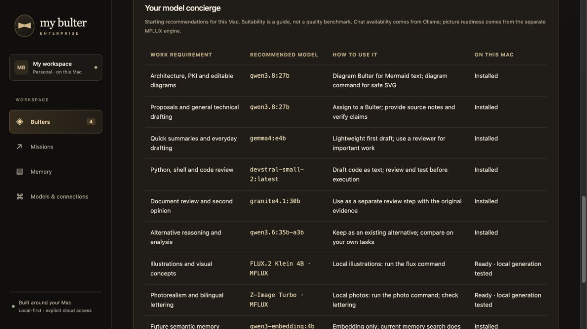
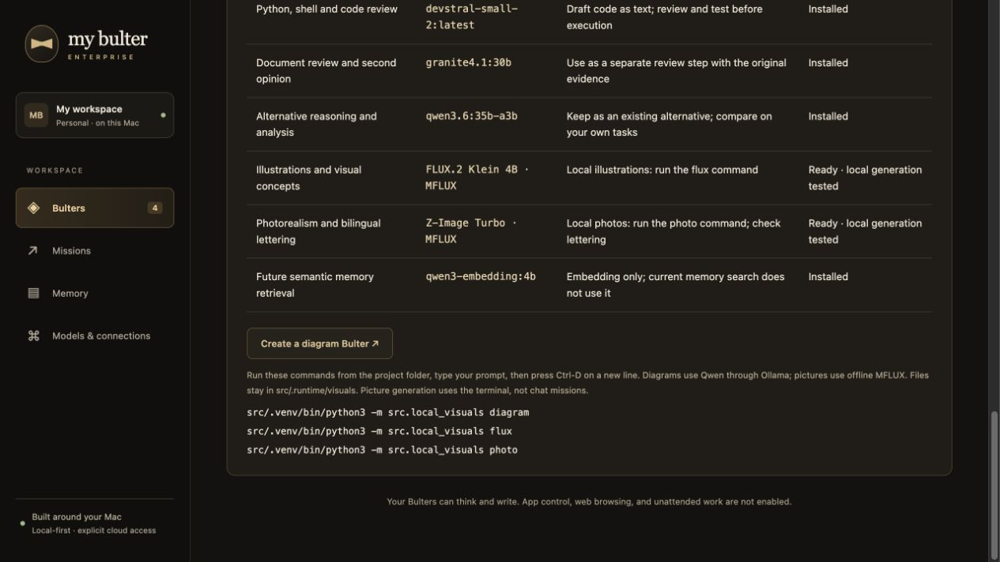

## My Bulter Enterprise — Application gallery

The Evening Service interface pairs warm charcoal with ivory and brass accents.
The initial screenshots use synthetic demonstration data; later captures are labelled individually.
No screenshot exposes private vault text, inbox content, credentials or paid-provider account data.

### Connected accounts — Chrome capture, 27 October 2026

This is an actual Chrome capture of the development instance: Google OAuth is authorized, Telegram is paired, and the browser card records a successful earlier capture. Credential-entry fields are empty; Telegram identifiers are omitted from the status display. LinkedIn remains a manual workflow, not a connected inbox integration. These connections are instance-specific and are not bundled with the source.

### Dashboard

Assign a specialty and a local or cloud model to each Bulter.

### Missions and handoffs

Give the team a brief, choose its order and inspect each contribution.
This screenshot uses a seeded demonstration mission, not a live model benchmark.

### Memory controls

Choose shared or private scope and keep notes local-only unless explicitly approved for cloud use.
The demonstration workspace has no Obsidian vault attached; the screenshot shows manual example notes.

### Models and connections

Connect local Ollama or LM Studio, or configure paid-provider APIs separately.
The screenshot uses a simulated model-discovery response; model IDs are placeholders.

### Document upload and review

Extract documents locally, inspect each part and explicitly approve local-only shared memory in Obsidian. This screenshot uses a synthetic test note.

## Warnings

- This gallery shows an application preview, not a hosted service. GitHub Pages cannot run the Python/Ollama backend.
- Never replace these images with screenshots containing private notes, customer information, credentials or personal mission history without review.

## Model concierge

Work recommendations with live chat availability and verified MFLUX picture readiness. This screenshot shows model guidance only, with no personal notes or credentials.

## Local image examples

Synthetic samples generated locally with MFLUX 0.23.0 at 512 × 512, seed 42. No personal memory or customer content was used. JPEG previews are provided here; the release kit includes original PNG files.

### FLUX.2 Klein 4B · 4-bit

### Z-Image Turbo · 4-bit

### Verified picture engine

