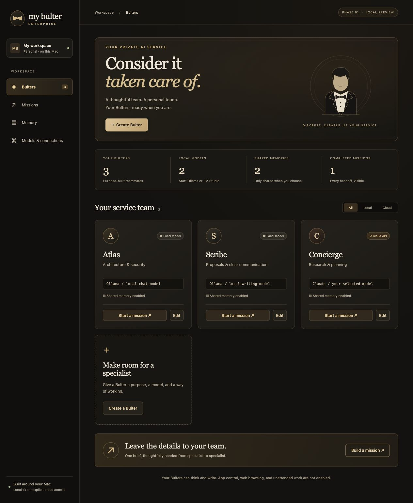
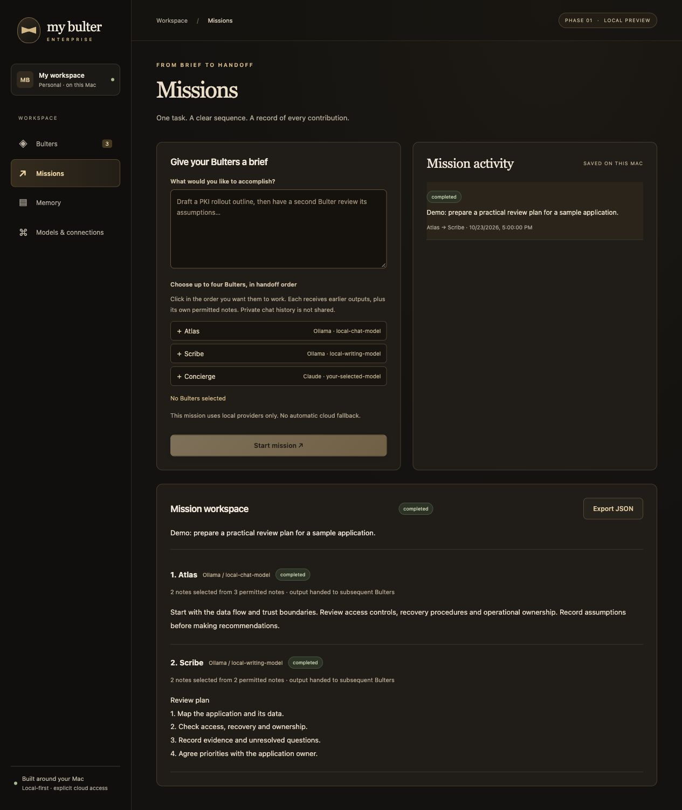
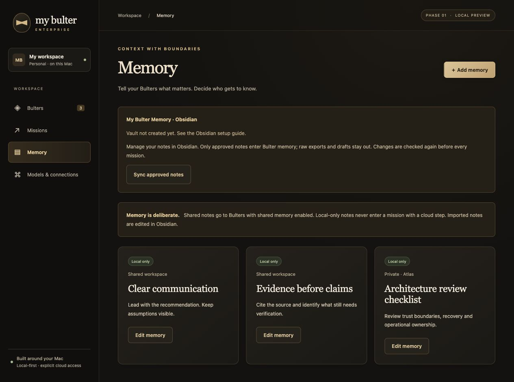
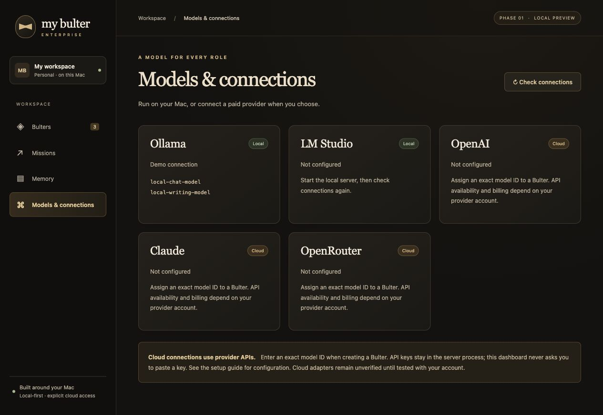
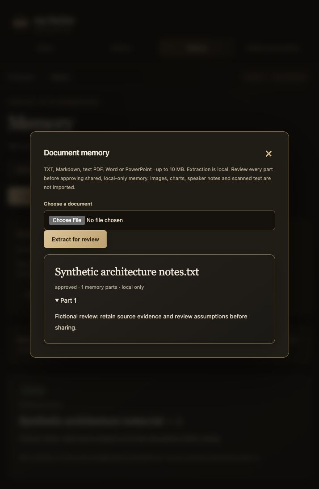

## My Bulter Enterprise — Application gallery

The Evening Service interface pairs warm charcoal with ivory and brass accents.
These screenshots show the real application with **synthetic demonstration data**.
Names, model IDs, connection states, notes and mission outputs are illustrative.
They do not expose a user's private vault or demonstrate a paid-provider connection.

### Dashboard

Assign a specialty and a local or cloud model to each Bulter.

### Missions and handoffs

Give the team a brief, choose its order and inspect each contribution.
This screenshot uses a seeded demonstration mission, not a live model benchmark.

### Memory controls

Choose shared or private scope and keep notes local-only unless explicitly approved for cloud use.
The demonstration workspace has no Obsidian vault attached; the screenshot shows manual example notes.

### Models and connections

Connect local Ollama or LM Studio, or configure paid-provider APIs separately.
The screenshot uses a simulated model-discovery response; model IDs are placeholders.

### Document upload and review

Extract documents locally, inspect each part and explicitly approve local-only shared memory in Obsidian. This screenshot uses a synthetic test note.

## Warnings

- This gallery shows an application preview, not a hosted service. GitHub Pages cannot run the Python/Ollama backend.
- Never replace these images with screenshots containing private notes, customer information, credentials or personal mission history without review.
