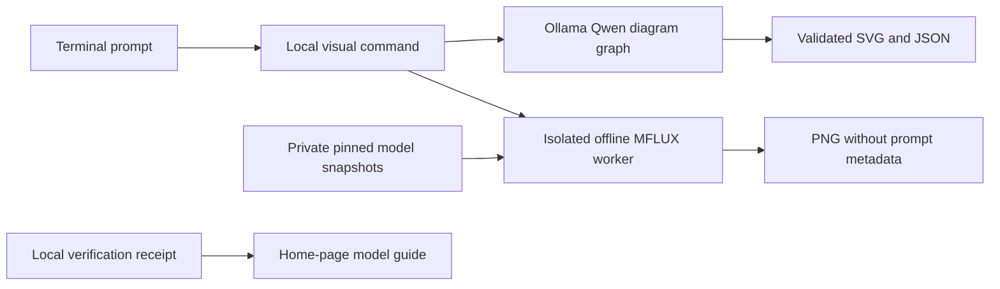

## Local diagrams and pictures

### Architecture and prerequisites

The application uses two independent local engines:

| Work | Engine | Model and settings |
| --- | --- | --- |
| Editable technical diagrams | Existing Ollama | Qwen3.8:27b; structured graph JSON rendered to SVG |
| Illustrations and visual concepts | MFLUX 0.23.0 / MLX 0.32.4 | FLUX.2 Klein 4B, 4-bit, 4 steps |
| Photorealistic pictures | MFLUX 0.23.0 / MLX 0.32.4 | Z-Image Turbo, 4-bit, 9 steps |

- Tested setup targets Apple Silicon macOS with 64 GB unified memory and Python 3.12. The image dependencies require a compatible recent macOS release; the pinned MLX wheel used here targets macOS 26+.
- Pillow is pinned to 12.3.0 because Pillow 13 failed to import on the tested Python 3.12 interpreter.
- The image environment is isolated in `src/.runtime/mflux-venv`. It does not replace Ollama, alter its version, or change the application virtual environment.
- Reserve approximately 15 GB for the isolated engine, 10.6 GB of image weights and initial outputs. Existing Ollama weights and partial downloads require additional disk space.
- No provider API key or Hugging Face login is required for these public snapshots. Downloads use the internet; generation uses local files with Hugging Face and Transformers offline modes enabled.
- The home-page model concierge table reads chat availability from Ollama and image readiness from local verification receipts. Installation alone is not reported as tested readiness.



### Install or resume image setup

From the project folder:

```zsh
python3 scripts/setup_images.py
```

The script installs the pinned optional dependencies in `src/image-requirements.txt`, then downloads only weights, tokenizer data and model metadata. It does not download or execute model-repository Python files. Interrupted transfers resume. Standard HTTP transport is selected because the initial Xet transfer stalled on the development Mac.

Model snapshots are pinned in `src/image_engine.py`:

| Task | Snapshot source | Revision |
| --- | --- | --- |
| flux | mlx-community/flux2-klein-4b-4bit | 860e87183ceb29e39627c0612ebd66d8ea66e68c |
| photo | filipstrand/Z-Image-Turbo-mflux-4bit | b3a8f31115a11f2f9e2fa0bfbc8d78dcc3e6568b |

These are quantized derivatives of Black Forest Labs FLUX.2 Klein 4B and Tongyi Z-Image Turbo. They use the MFLUX saved-weight format, not the Ollama format. Their model cards and underlying model licenses remain relevant when distributing weights or using outputs commercially. No weights are bundled in the GitHub source package.

### Generate pictures

Start with 512 × 512; use `--size 768` or `--size 1024` for larger output. The default is 768. `--seed` defaults to 42 and accepts a non-negative 32-bit integer.

```zsh
src/.venv/bin/python3 -m src.local_visuals flux --size 512 <<'PROMPT'
A warm charcoal and brass editorial illustration of a formal butler welcoming a guest into a quiet library, no text.
PROMPT

src/.venv/bin/python3 -m src.local_visuals photo --size 512 <<'PROMPT'
A cinematic photograph of a quiet library with brass lamps, dark wood shelves and warm evening light, no people, no text.
PROMPT
```

Each job saves `image.png` and a small `generation.json` record in a new private folder under `src/.runtime/visuals`. The command reports its exact location. The record contains engine/model revision, seed, dimensions, steps and generation duration, not the prompt. PNGs are saved from fresh pixels without prompt/EXIF metadata.

Alternatively, enter a command without the heredoc, type the prompt, then press Ctrl-D on a new line. Prompts are passed to the worker over standard input rather than exposed in command-line arguments. Only the two fixed model choices are supported; there are no arbitrary executable paths or shell commands.

Generation takes place in a subprocess with a 15-minute timeout and a process lock that prevents two image jobs running simultaneously. Completion releases the worker and its GPU allocation. Other applications, including Ollama, can still use GPU memory; avoid simultaneous large inference jobs. Raw engine logs are not exposed as application errors. A failed job keeps its output directory for inspection; nothing is deleted automatically.

After one successful job per model, **Models & connections → Check connections** refreshes the home-page readiness labels. The lightweight check verifies that the receipt matches the pinned model and that recorded files still exist at their expected sizes. It is a readiness check, not a cryptographic integrity audit of local files.

### Generate editable diagrams

```zsh
src/.venv/bin/python3 -m src.local_visuals diagram <<'PROMPT'
Draw a simple architecture: User sends a request to My Bulter Enterprise, which calls local Ollama. Ollama returns the response to My Bulter Enterprise. No cloud services.
PROMPT
```

The new job folder contains `diagram.svg` and `diagram.json`. The fixed renderer accepts at most 12 nodes and 20 edges, validates IDs, escapes text and emits only fixed SVG elements. It does not execute generated SVG, scripts, links or HTML. The layout is deliberately simple; it is not a full diagram editor.

For Mermaid source, use the saved **Draftsman** Bulter with Qwen3.8. Mission output remains text. The standalone visual commands do not read Obsidian; normal Bulter missions retain the existing memory permissions.

### Compatibility history

Ollama 0.40.11 rejected a real FLUX image request even after its weights downloaded. Z-Image's Ollama download was stopped at roughly 8%. The January image-generation announcement was outdated for that build. The separate MFLUX engine avoids downgrading Ollama. The existing FLUX Ollama weights and interrupted original-precision MFLUX downloads were retained; they are not used by the new 4-bit pipeline.

### Verification

Automated checks cover offline worker invocation, no prompt in argv, secret-environment exclusion, missing engines, receipt/file consistency, safe SVG rendering and chat/image model separation. Both pinned 4-bit snapshots downloaded successfully and generated real 512 × 512 images with seed 42. FLUX completed end-to-end in approximately 7 seconds (5.42 seconds inside generation); Z-Image completed in approximately 12 seconds (7.07 seconds inside generation). These are single smoke tests, not controlled comparative benchmarks. Both images were visually inspected, decoded successfully and contained no embedded metadata. The generated examples are synthetic and contain no user memory.

The application suite passes 83 tests, JavaScript syntax validation and release allowlist checks. The image environment passes `pip check`, imports both model implementations and executes an MLX GPU calculation. The source package includes reviewed JPEG previews; the upload kit also contains the original PNG samples.

### Sources

- [MFLUX engine](https://github.com/mflux-community/mflux)
- [FLUX.2 implementation](https://github.com/mflux-community/mflux/blob/main/src/mflux/models/flux2/README.md)
- [MLX community FLUX 4-bit snapshot](https://huggingface.co/mlx-community/flux2-klein-4b-4bit)
- [MFLUX author's Z-Image 4-bit snapshot](https://huggingface.co/filipstrand/Z-Image-Turbo-mflux-4bit)
- [Ollama image-runtime incompatibility](https://github.com/ollama/ollama/issues/17893)

## Warnings

- Review technical diagrams, image content and lettering before using them in work.
- Keep private prompts, images and runtime files out of public repositories. The package contains only reviewed synthetic examples.
- Image generation currently uses terminal commands. The dashboard shows recommendations and readiness; it does not yet have a picture-generation form or gallery.
