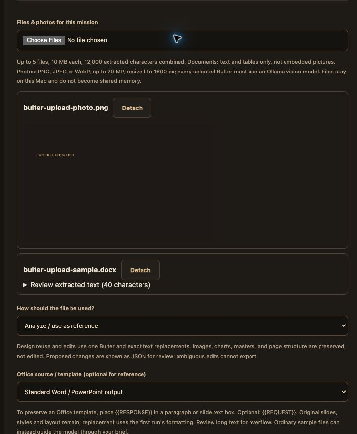

## Mission files and photos

Each new mission accepts up to five attachments. Open **Missions**, choose files, review the extracted text or photo preview, choose Bulters and start the mission. Completed and failed missions retain their selected references for review. Detach removes a file from the current selection; it does not delete its locally retained source.

| Input | Analysis | Limits |
| --- | --- | --- |
| TXT, Markdown, text PDF | Extracted text | 10 MB/file; 12,000 extracted characters combined |
| DOCX, PPTX | Text and tables | Embedded pictures, charts, notes and scanned content are not visually analyzed |
| PNG, JPEG, WebP | Ollama vision | Still photos, at most 20 megapixels; normalized JPEG at up to 1600 pixels |

Files are stored in the instance's private runtime database, excluded from source releases. They are not imported into Obsidian or shared memory. At most 200 attachments can be retained in this initial implementation. There is no automatic cleanup or deletion. Upload only files you intend to retain locally.

## Choose the output behaviour

| Mode | Result |
| --- | --- |
| Analyze / use as reference | A normal analysis with standard Word and PowerPoint downloads |
| Create new content using its design | A new copy with proposed text substitutions in the selected Office sample |
| Edit existing document or slides | A new copy with only requested text substitutions |
| Fill explicit template placeholders | Replace `{{RESPONSE}}` and optional `{{REQUEST}}` in an Office template |

For design reuse or edits, select the uploaded DOCX/PPTX as **Office source**, and choose one Bulter. Describe precisely what to replace and what to retain. The response is a JSON list of proposed `old` and `new` paragraph texts for review. **Download using [filename]** applies only unique, exact source matches; malformed or ambiguous edits are rejected. All other package parts remain unchanged. Repeated identical paragraphs cannot currently be targeted individually. This is text editing within the source design, not an autonomous slide designer: it does not move objects, replace pictures, add slides or redraw charts. Source sample wording not selected for replacement remains present.

Placeholder templates must contain `{{RESPONSE}}` in a paragraph or slide text box; a marker may span formatted runs. Use the separate template download after completion. Replacement text uses the first run's formatting; review line breaks and text overflow in Word or PowerPoint. Large responses may not fit the original text box. Original uploads are never overwritten.

## Privacy and security

- All API uploads and previews require the instance session token and existing same-origin checks.
- Document extraction runs in a subprocess with a 30-second wall limit and CPU limit. Office ZIP and macro checks apply.
- Photos are decoded and re-encoded without original EXIF metadata before inference. The original upload remains in private storage.
- Every photo recipient must advertise Ollama `vision` capability. Photos currently cannot be sent to cloud providers or LM Studio. See [Ollama vision API](https://github.com/ollama/ollama/blob/main/docs/capabilities/vision.mdx).
- Documents require both mission cloud consent and separate attachment consent before any cloud team receives them. Filename, extracted content and derived handoffs can leave the Mac only with those approvals.
- Uploaded content is untrusted reference material, not authority to perform actions. Prompt boundaries reduce but cannot eliminate prompt-injection risk.
- Generated Office copies reject external relationships and embedded objects. No uploaded macros or external links are executed.

## Warnings

- Extraction covers supported text, not every visual element. Upload a separate photo/screenshot to analyze a visual with a local vision model.
- Large references are rejected without silent truncation. Split them into smaller missions.
- Model changes require human review for factual accuracy, missing edits, formatting and overflow before distribution. Source-preserving exports may retain original metadata and unedited content; inspect before sharing.

## Verification — 28 October 2026

- 104 automated tests passed, including authenticated upload, mission isolation, cloud-consent rejection, vision capability checks, image delivery and Word/PowerPoint source-preserving exports.
- Chrome uploaded and previewed a synthetic photo and Word sample; edit-mode and source selection were checked.
- Live local `gemma4:e4b` correctly read “SYNTHETIC UPLOAD TEST” from the test photo. Both installed `gemma4:e4b` and `qwen3.8:27b` reported vision capability.
- Cloud document inference was not exercised against a paid account. Exact edit generation remains dependent on the selected model returning valid replacements; ambiguous results are rejected.
- Existing test dependency warning: Starlette warns that its httpx-backed TestClient is deprecated. Tests passed; no dependency migration was made.

