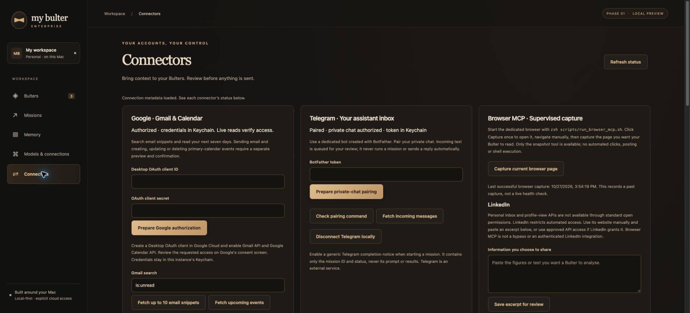

## Connector release and GitHub publishing — 27 October 2026

### Changes included

- Google Desktop OAuth with PKCE, expiring state and instance-specific Keychain storage.
- Gmail snippet search and confirmed plain-text email sending.
- Primary Calendar reads and confirmed event creation, updates and deletion; revision checks protect updates/deletions.
- Telegram private-chat pairing, incoming-text review, confirmed replies and per-mission generic status notifications.
- Pinned Microsoft Playwright MCP 0.0.83 launcher and supervised snapshot adapter.
- Local-only reference inbox; connector content is refused for cloud-model missions.
- Frozen action previews, expiry, duplicate-attempt protection and auditable outcomes.
- Updated connector setup, architecture, security documentation and Chrome screenshot.
- The complete source package also contains previous model selection, Bulter management, Obsidian memory, document import/export and local image-engine work.

### Verified state and limitations

| Item | Evidence as of release preparation |
| --- | --- |
| Google | OAuth authorized in the development instance; successful Gmail fetch records exist |
| Calendar | Permissions requested and implementation tested with mocks; no live event mutation claimed |
| Telegram | Private chat paired; no outgoing live-message test claimed in this release preparation |
| Browser MCP | Real local adapter/snapshot test passed; latest successful capture timestamp shown in screenshot |
| LinkedIn | Manual excerpt workflow only; no personal inbox/profile-views API connection |
| Automated tests | 98 passed; one existing Starlette TestClient deprecation warning |
| Source packaging | Explicit allowlist, credential/path-pattern scan, ZIP integrity and SHA-256 manifest |

Connections, tokens, account IDs, private messages, personal mission results, vault files, model weights and Python environments are not distributed. Each installation must authorize its own accounts. The screenshot shows the actual connection states without revealing account identifiers or credentials.



### Publish from the existing local Git repository

These steps publish the source files to `https://github.com/cartertan/my-bulter-enterprise`. The release was prepared on `main`; local HEAD and `origin/main` matched before the release commit. No commit or push was performed while preparing these instructions.

Open Terminal in the existing project folder, then run:

```zsh
git branch --show-current
git remote -v
git status --short
git fetch origin
git rev-list --left-right --count HEAD...origin/main
```

Expected branch: `main`. Expected remote: the repository above. The final command was `0 0` during preparation. If the right-hand count is nonzero, GitHub has newer commits: reconcile them before continuing. Do not force-push or reset away local changes.

Run the checks:

```zsh
src/.venv/bin/python3 -m pytest src/tests -q
node --check src/static/app.js
node --check src/static/connectors.js
src/.venv/bin/python3 scripts/package_release.py --check
git diff --check
```

Stop if any check fails. Then stage only the reviewed release files:

```zsh
git add -- scripts/package_release.py scripts/run_browser_mcp.sh \
  src/README.md src/app.py src/connectors.py src/connector_routes.py \
  src/static/app.js src/static/connectors.js src/static/index.html src/static/style.css \
  src/tests/test_connectors.py src/tests/test_package.py \
  src/docs/ARCHITECTURE.md src/docs/SECURITY.md src/docs/CONNECTORS.md \
  src/docs/GALLERY.md src/docs/UPLOAD_2026-10-27.md \
  src/docs/screenshots/connectors-connected.jpg
git diff --cached --stat
git diff --cached --check
git diff --cached --name-only
```

Review the filenames and diff. If unrelated files were already staged, unstage those particular files before committing. No `.runtime`, vault, `.env`, client-secret JSON, database, token or Keychain export should appear.

```zsh
git commit -m "feat: add Google Telegram and supervised browser connectors"
git fetch origin
git merge-base --is-ancestor origin/main HEAD
```

The last command must finish successfully (exit code zero). If it fails, remote history has changed: stop and reconcile it before publishing. Otherwise:

```zsh
git push origin main
```

Use your normal GitHub authentication. Never put a token in the remote URL or a project file. If push is rejected, preserve remote history and resolve the reason; do not force-push.

### Verify the GitHub update

1. Open the repository and check the latest commit message.
2. Open `src/README.md`, `src/docs/CONNECTORS.md` and `src/docs/GALLERY.md`.
3. Confirm that `src/docs/screenshots/connectors-connected.jpg` renders correctly.
4. Inspect the changed-file list for accidental personal files.

### Source ZIP

The generated ZIP under `src/.release/` contains all allowlisted source files, the screenshot, documentation and `SOURCE_MANIFEST.json`. Use it for backup or a clean installation. The Git commands publish the browsable source; do not replace the repository with only a ZIP. Generate another reviewed archive later with:

```zsh
src/.venv/bin/python3 scripts/package_release.py
```

### Warnings

- The displayed account connections belong only to the local instance. Credentials and personal runtime data must remain outside GitHub.
- The screenshot confirms recorded authorization/pairing, not guaranteed ongoing access or successful writes. Google Testing-mode grants may expire.
- Gmail/Calendar writes and Telegram replies require review and confirmation. Browser MCP does not enable unattended LinkedIn access.
- GitHub Pages cannot run the Python, Ollama or browser-MCP backend.
