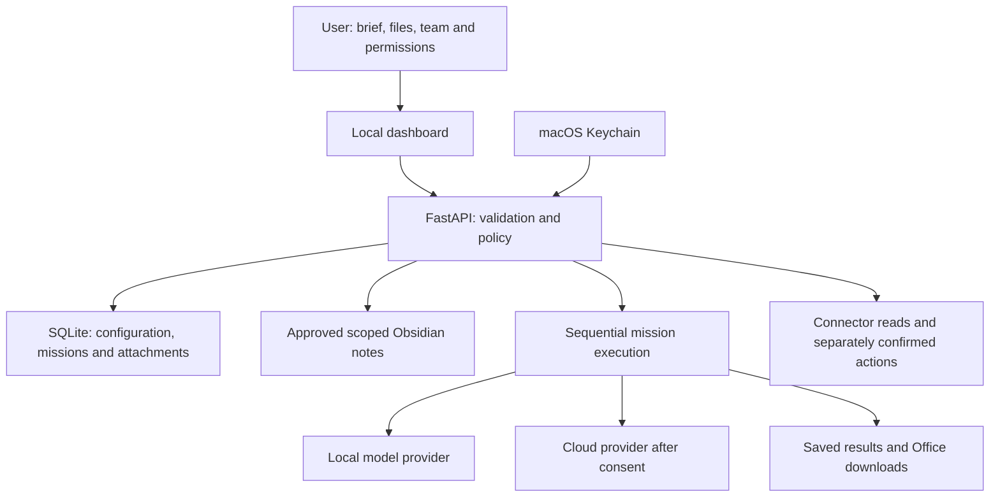

## My Bulter Enterprise: An End-to-End Product Management Case Study

**Author:** Carter Tan  
**Prepared:** 28 October 2026  
**Purpose:** Explain how to direct an AI-assisted software project using Codex and GitHub, with practical lessons from a local multi-model assistant application.

### 1. What we set out to achieve

The starting idea was a Grok-style experience running on a MacBook, with named assistants using different local or paid models. The user chose an original dashboard. The resulting product grew to include controlled memory sharing, missions, document workflows and account connectors.

A clear product statement for this project is:

> For an individual professional who uses several AI models and has reusable working knowledge, My Bulter Enterprise provides a local dashboard to configure specialist assistants, run visible workflows and review their outputs while explicitly controlling access to memory and external services.

The first product-management lesson is to translate a reference product into observable user needs. A visual reference is useful, but it does not define architecture, data permissions or completion criteria.

### 2. Actual history versus the ideal process

| Observed development | Product-management interpretation | Better next iteration |
| --- | --- | --- |
| An initial chat concept expanded into bots, memory, files, exports and connectors | Discovery continued during implementation | Record new ideas in a backlog instead of silently expanding the active task |
| Original UI was selected, followed by a warmer dark redesign | Design preferences became clearer through use | Approve one key-screen prototype and interaction flow early |
| Editing existing Bulter models and removing Bulters became explicit requirements | Lifecycle behaviour was missing from the initial feature framing | Specify create, edit, remove, restore and historical behaviour together |
| Shared Obsidian knowledge and per-mission uploads became separate workflows | Persistent memory and task-specific evidence are different product objects | Decide ownership, retention and sharing rules before storage design |
| Credential storage was refined to instance-scoped macOS Keychain | Security requirements changed implementation choices | Agree credential and data-flow boundaries during architecture review |
| Connector and model setup required live local verification | Implemented adapters do not establish working accounts or models | Track implementation, automated tests and live verification separately |
| Office upload requests expanded into design reuse and editing | One request contained several distinct output contracts | Split analysis, template filling and precise editing into separate deliverable slices |

This table is a retrospective interpretation. The original project did not start with a formal backlog, stage gates or measured delivery baseline. See the [initial build record](../BUILD_ACTIVITY.md) for its historical account; its remaining-scope section reflects the initial checkpoint and is not today's backlog.

### 3. Prepare the inputs before implementation

The owner should provide the business facts and boundaries. Codex can help turn them into technical plans.

| Input | Concrete example | Why it matters |
| --- | --- | --- |
| Intended user | One professional using a personal Mac | Avoids prematurely designing multi-tenant hosting |
| Main job | Give a specialist a brief and review a useful result | Defines an end-to-end flow rather than a collection of screens |
| MVP | Configure Bulter, select Ollama, run mission, save output | Creates a small demonstrable first release |
| Environment | macOS, installed Ollama, Python application | Grounds setup and integration decisions |
| Data boundaries | Local-first; cloud transfer requires consent | Shapes retrieval and provider routing |
| UI preference | Warm dark dashboard with visible status | Gives a testable design direction |
| Examples | Synthetic proposal, presentation and image | Enables tests without exposing private information |
| Definition of success | Output persists after restart; failures remain visible | Makes completion observable |
| Explicit exclusions | No autonomous email sending; no shared deployment | Prevents accidental scope and access expansion |

Start with one or two pages. More documentation is useful only when it answers a decision or prevents repeated work.

### 4. Prioritize by dependency and user value

The following is a **recommended delivery sequence**, not a claim that the original work used these exact milestones or release numbers.

| Milestone | User value | Demonstration / exit condition |
| --- | --- | --- |
| M0: foundation | Application can be installed and operated | Empty instance launches, test command works, private files are excluded |
| M1: working local mission | One Bulter produces a saved answer | Configure local model, run task, review result, restart and recover history |
| M2: identity and memory | Specialists use appropriate knowledge | Model changes affect future runs; private/shared/local-only policies tested |
| M3: document outputs | Useful work becomes portable | Upload reference, inspect extraction, download readable Word/PPTX |
| M4: secure external connections | Account information can support workflows | Setup states are truthful; reads work; writes need exact review and confirmation |
| M5: richer mission attachments | Samples and photos support individual tasks | Mission-only storage, local vision check, bounded analysis, validated Office copy |
| M6: repeatable release | Another user can install safely | Clean setup documented, tests pass, release excludes personal state |

Treat a milestone as a small set of issues, not a single giant Codex prompt. Decide priority from user value, risk and dependencies. A connector may be valuable, but it should not bypass the credential and action-approval foundations it depends on.

### 5. Architecture as a product decision

The implementation uses a FastAPI backend, a buildless HTML/CSS/JavaScript interface, SQLite persistence, provider adapters, scoped Obsidian retrieval and a connector layer. This is suitable for a local single-user prototype. It is not a ready-made multi-user service.

Key design decisions and their product implications:

- **Bot identity is independent of the model.** Users can change the model without recreating the specialist; saved mission snapshots explain historical results.
- **Collaboration is ordered and visible.** A mission hands outputs to subsequent Bulters; it is not an autonomous swarm.
- **Memory access is enforced before inference.** A model instruction alone is not an access-control mechanism.
- **Mission attachments are separate from durable memory.** Supplying a sample does not automatically authorize future use by other tasks.
- **Connector actions have their own approval path.** A generated answer is not authorization to send an email or change a calendar.
- **Local credentials are not portable source.** A new installation connects its own accounts and models.

Record important decisions briefly: context, choice, alternatives, consequences and when to reconsider. For example, reconsider single-user architecture before exposing the app to other users; do not reinterpret its name as proof of tenant isolation.

### 6. Work one feature from discovery to acceptance

Consider the actual request: allow missions to upload documents and photos for analysis, conversion or use as templates.

**Discovery:** Clarify what “template” means. The owner selected both new content using a sample's design and edits to existing documents/slides. These are different outputs and need separate controls.

**Scope:** The implemented increment supports text/document extraction, normalized local photos, reference analysis, explicit placeholders, and validated exact-text substitutions in Office copies. It does not automatically redesign slides, modify charts or edit embedded pictures.

**Recommended issue breakdown:**

| Issue | User story | Acceptance example |
| --- | --- | --- |
| A: upload and preview | I can inspect the material before using it | Valid DOCX shows extracted text; malformed input is rejected |
| B: mission reference | Only this mission receives my selected file | File reaches inference and is absent from shared memory |
| C: photo analysis | My local vision model can inspect a photo | Non-vision recipients are rejected before inference |
| D: Office template | I can fill a deliberate output template | Markers are replaced and the original remains unchanged |
| E: Office edits | I can request grounded changes in a sample | Unique source matches apply; ambiguous changes cannot export |
| F: release evidence | I can install and understand the feature | Guide, tests, privacy-safe screenshot and source package are present |

**Security acceptance:** Authentication applies to uploads and previews; oversized inputs fail visibly; local-only rules are enforced; cloud document sharing needs explicit permission; generated Office copies reject external relationships and embedded objects.

**Verification:** Use synthetic fixtures for automated tests and a small local smoke test for real model behaviour. A mocked image-delivery test proves request construction; a live image test proves that one actual model/runtime combination responded. Neither proves accurate interpretation of every document or photo.

**Observed checkpoint:** The attachment guide records 104 passing tests, Chrome photo/Word upload verification and a successful local synthetic-image reading test. That is a dated development result, not a guarantee of current test status or universal model quality. See [mission attachment evidence and limitations](../MISSION_ATTACHMENTS.md).

**Release decision:** Accept the implemented scope with explicit limitations, or create follow-up issues for missing behaviour. Do not label a text-replacement feature “full presentation redesign.”

### 7. Structure GitHub around decisions and evidence

A basic repository, Issues and pull requests are enough to start. A project board is optional. GitHub Actions can later run repeatable checks; local Ollama and macOS Keychain checks remain separate unless a suitable environment is deliberately provided.

| Artifact | What it owns | Avoid putting here |
| --- | --- | --- |
| Product brief | Purpose, users, MVP, exclusions | Full implementation history |
| Architecture and decision notes | Components, boundaries and rationale | Repeated task status |
| GitHub issue | One outcome and its acceptance criteria | An entire product roadmap disguised as one task |
| Feature specification | Detailed behaviour shared across related issues | Copied chat transcripts |
| Pull request | Actual change, validation and review questions | Unsupported claims of successful live testing |
| Project state / handover | Current checkpoint and next action | Growing journals of every command |
| Release notes | Shipped changes, limitations and setup changes | Personal runtime data |

Suggested issue states: **Backlog → Ready → In progress → Review → Done**. Track **Blocked** separately with the concrete missing prerequisite.

An issue is **Ready** when its outcome, dependencies, examples and acceptance criteria are clear. It is **Done** when the behaviour is verified, relevant tests pass, the change is reviewed, and documentation reflects material limitations. Do not close it merely because code was generated.

### 8. A Codex workflow that limits repeated context

Use one focused chat per coherent outcome. Start with the relevant issue, repository instructions and specification. Let Codex inspect related code as needed instead of pasting the entire history or forbidding useful investigation.

1. **Preflight:** Inspect current files, working-tree changes and applicable instructions.
2. **Plan:** Explain the smallest implementation and any material unanswered question.
3. **Build:** Complete the bounded issue and preserve unrelated work.
4. **Verify:** Run relevant tests, inspect failures and review the diff. Run UI checks when visible behaviour changed.
5. **Review:** Assess privacy, failure cases and acceptance criteria, not just the happy path.
6. **Handover:** Record verified status, limitations, changed files and the next action in a short note.
7. **Publish:** Commit and push the reviewed scope when authorized; distinguish preparation from publication.

For routine authorized implementation, avoid approvals after every edit. Reserve owner decisions for material scope changes, design tradeoffs and consequential actions. A long sequence of unnecessary confirmations also consumes time and context.

Maintain short durable instructions in `AGENTS.md`, and link task-specific documents rather than loading every document into every chat. OpenAI recommends goal, context, constraints and completion criteria in task prompts, and warns against one chat spanning an entire project. See [official Codex best practices](https://learn.chatgpt.com/docs/learn/best-practices) and [the development-workflow example](https://developers.openai.com/cookbook/examples/codex/iterating-development-workflows-with-codex).

A new chat can reduce accumulated context; it does not reset account usage limits. Parallel agents can increase total consumption. No percentage token saving was measured in this project. Measure repeated discovery, rework and successful delivery rather than claiming efficiency from shorter prompts alone.

### 9. Lessons learned and corrective actions

| Lesson | Evidence from this project | Practice to adopt |
| --- | --- | --- |
| Define outcomes before choosing integrations | Models, memory and connectors evolved from a broad dashboard idea | Start with user workflows and bounded milestones |
| Include the full object lifecycle | Existing Bulter model editing and removal needed refinement | Specify creation, update, removal, restore and history |
| Separate temporary evidence from durable knowledge | Obsidian import and mission uploads serve different purposes | Make retention and future reuse explicit |
| Design security into the workflow | Keychain, cloud consent and connector confirmations affect UI and storage | Add privacy acceptance criteria to each relevant issue |
| Test capability, not just configuration | A saved model or credential is not a successful live call | Report configured, reachable and verified states distinctly |
| Clarify ambiguous product vocabulary | “Template” meant both design reuse and editing | Ask one targeted question before committing to output semantics |
| Keep publication deliberate | Source packaging excludes runtime data | Use an allowlist and review the staged diff |
| Manage task size | One conversation accumulated many unrelated feature areas | One coherent outcome per chat with a compact handover |
| Use modest claims | Mocked cloud tests and local smoke tests have different coverage | Publish evidence boundaries alongside capabilities |

### 10. Measure progress without inventing results

The following metrics are proposed for future use; they were not systematically collected during the original build.

| Measure | How to collect it | Why it helps |
| --- | --- | --- |
| Time from Ready to accepted | Issue and review timestamps | Reveals oversized tasks and waiting time |
| First-review acceptance | Issues accepted without scope rework / reviewed issues | Tests specification clarity |
| Escaped defects | Bugs found after a release | Indicates missing acceptance cases |
| Setup success | Clean-install checklist result | Tests whether source is actually reusable |
| Verified integration coverage | Matrix of mocked and live checks | Prevents inflated capability claims |
| Context reconstruction | Record repeated discovery or handover failures | Identifies documentation gaps |
| Usage per accepted outcome | Available account usage observations, with attribution limits | Supports experiments without assuming precise per-task token billing |

Do not optimize for the smallest code diff or fewest tokens at the expense of correctness. Compare similarly sized tasks, and record whether failures or changed requirements caused extra work.

### 11. Apply the learning to the next increment

For this existing repository, do not restart the application from scratch. First audit the current branch and tests, then record a short baseline. Pick one concrete gap, such as clearer Office-edit review, attachment lifecycle management or a missing provider's live validation. Use the [work templates](WORKFLOW_TEMPLATES.md) to specify it and create its issue.

The owner defines useful outcomes and accepts tradeoffs. Codex investigates, implements and supplies evidence. GitHub preserves the requirements, changes and review trail so the next chat does not need the entire conversation.

## Warnings

- This case study is educational and describes a local single-user application, not a security certification or production-readiness assessment.
- Historical tests and screenshots are dated evidence. Re-run the relevant checks for each release.
- Office outputs can retain unedited source content and metadata; review before sharing.
- Keep credentials, personal accounts, private memory, uploaded documents and sensitive screenshots out of public learning materials.
